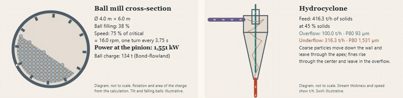
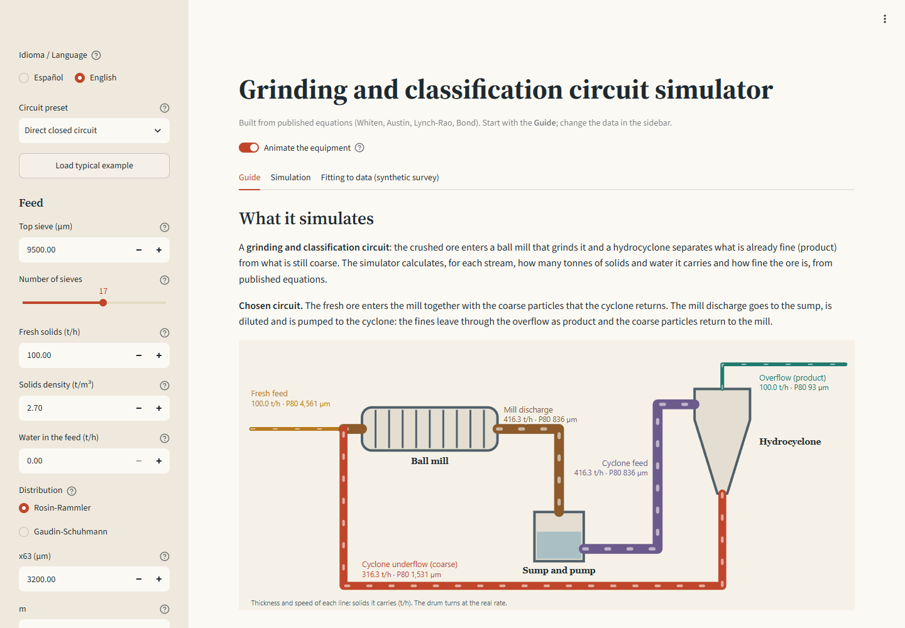
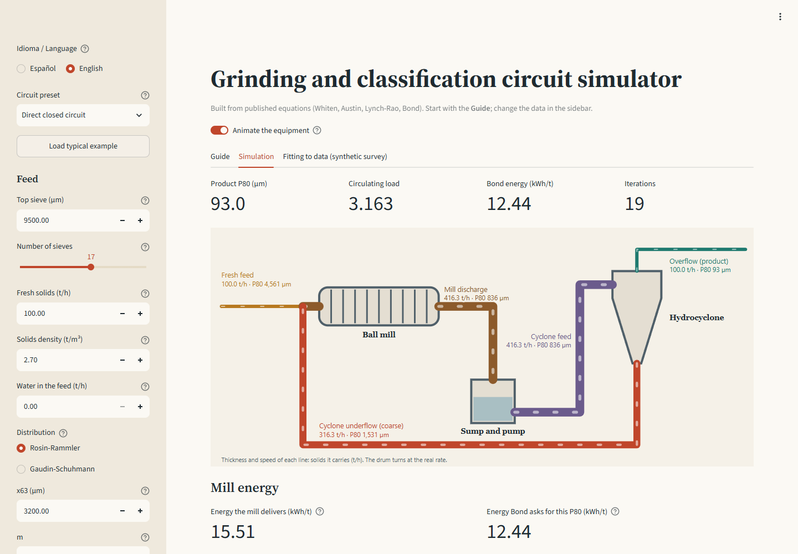
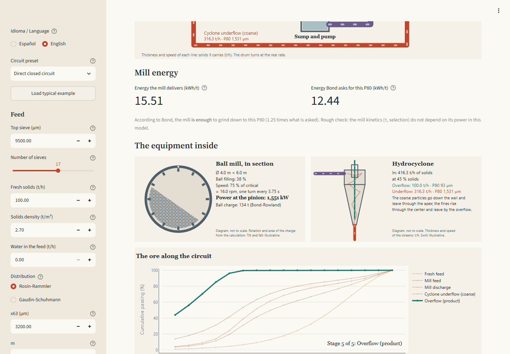
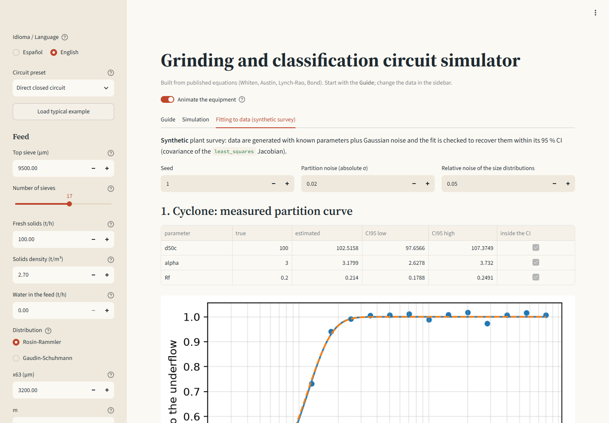

[Versión en español](README.md)

# conminucion — grinding & classification circuit simulator

Python simulator for ball-mill / hydrocyclone circuits, built from scratch from published equations (Whiten, Austin, Lynch-Rao, Kelsall, Bond).
Includes a modular flowsheet solver with recycles, plant-data reconciliation and parameter fitting with confidence intervals, and a Streamlit app.

[](https://github.com/Laxionx/simulador-conminucion/actions/workflows/ci.yml)
[](https://simulador-conminucion-mtxoolyzuvvcxrq8rce3el.streamlit.app/?lang=en)



**[Try it in the browser](https://simulador-conminucion-mtxoolyzuvvcxrq8rce3el.streamlit.app/?lang=en),
nothing to install.** The app has an Español / English selector at the top of the sidebar; `?lang=en` opens it in English. If nobody used it for a few days, the app is asleep: the button to wake it takes a minute.

## What it is

A simulator of grinding and classification circuits to learn and practice mass balance in comminution. It solves a ball mill (perfect mixing, Whiten/Austin), classification by efficiency curve with bypass (hydrocyclone and screen), Bond energy, circuits with recycle (open, direct closed and reverse closed), balance reconciliation at a node and fitting of parameters to plant data with 95 % confidence intervals.

## Why it was built from the published equations

The reference industrial simulators (for example JKSimMet) are closed software. This project does **not** copy, decompile or imitate code, files, formats or interface of any of them: everything comes from the equations of the literature, documented one by one in [`docs/teoria.md`](docs/teoria.md) (in Spanish). Writing it this way forces one to understand every assumption (normalization of the breakage, P80 interpolation, convergence criterion of the recycle).

## Screenshots

| Guide: what it simulates and what data it needs | Simulation with the animated flowsheet |
|---|---|
|  |  |
| **Energy and the equipment inside** | **Fitting with a synthetic survey** |
|  |  |

In the app, the drum turns at the mill's real rpm (% of the critical speed), the ball charge takes up the given filling and each stream is drawn with the thickness and speed of its flow. With "reduce motion" enabled in the system, the diagrams are shown still.

## How to run it

```bash
python -m venv .venv
.venv/Scripts/activate        # Windows (Git Bash: source .venv/Scripts/activate); Linux/macOS: source .venv/bin/activate
pip install -r requirements.txt
pip install -e .
streamlit run app/streamlit_app.py
```

Tests and style:

```bash
ruff check .
pytest --cov=conminucion --cov-report=term-missing
```

Cross-validation case (regenerates `docs/caso-validacion-modsim.md`):

```bash
python -m conminucion.validacion
```

Use as a library:

```python
from conminucion.sizes import SizeGrid, rosin_rammler
from conminucion.stream import Stream
from conminucion.mill import BallMill
from conminucion.classifier import EfficiencyCurve
from conminucion.circuits import CircuitConfig, simulate

grid = SizeGrid.geometric(top=9500, n=17)
fresh = Stream.from_fractions(grid, rosin_rammler(grid, 3200, 1.0), tph=100)
res = simulate("cerrado_directo", CircuitConfig(fresh, BallMill(), EfficiencyCurve(100, 3.0, 0.2)))
print(res.table(), res.circulating_load, res.bond_kwh_t)
```

(The circuit presets keep their Spanish identifiers: `abierto` = open, `cerrado_directo` = direct closed, `cerrado_inverso` = reverse closed.)

## What it includes

- Size classes, Rosin-Rammler and Gaudin-Schuhmann generators, log-linear P80/F80.
- Normalized Austin-Klimpel-Luckie breakage (the columns add up to 1, proven in the theory).
- Perfect-mixing mill with (r/d) by knots or Austin's selection function, N mixers.
- Whiten/Lynch-Rao efficiency curve with Kelsall's bypass (cyclone and screen).
- Mill with Herbst and Fuerstenau's specific energy selection: it scales with the net power, without residence time (equivalent to MODSIM's HFSU model).
- Ball-mill power from its dimensions, charge and speed (Bond-Rowland), validated against published worked examples.
- Ball wear: steady-state charge with the general law d^Δ, recharge balance and ball life, and Bond's (1964) consumption correlations. Validated with charges measured in a plant (Davis 1919); see [docs/desgaste.md](docs/desgaste.md) (in Spanish).
- Standard and short-head cone crusher (internal classification and Whiten's breakage): it reproduces the MODSIM reports with a deviation of 0.009 points or less; see [docs/chancado.md](docs/chancado.md) (in Spanish).
- Jaw crusher (kinematic capacity, nip angle, critical speed, power, Whiten or Nordberg product) and grizzly, with diagnostics; validated against King's Table 3.1, with the negative results documented in [docs/chancado.md](docs/chancado.md) (in Spanish).
- Plitt hydrocyclone (King's form, MODSIM's CYCL model): d50c, sharpness and water partition from the geometry, with the roping warning of Mular and Jull. It reproduces the MODSIM results; see [docs/plitt.md](docs/plitt.md) (in Spanish).
- Classifier by d25/d75 sharpness index (logistic, Rosin-Rammler or exponential sum), with bypass and d50 scaling by density (equivalent to MODSIM's CYCA model).
- Sequential-modular solver with tear streams and optional Wegstein.
- Node reconciliation by weighted least squares with constraints.
- Fitting of d50c, α and Rf (cyclone) and of r/d by knots (mill), CI by covariance of the Jacobian.
- Synthetic plant survey that checks the recovery of parameters within their CI.
- Streamlit app with a guide (what it simulates, equations, what data it needs and how each one is measured in a plant), the flowsheet and the equipment animated with data from the calculation, the convergence of the recycle and the size distribution stage by stage, mill power (Bond-Rowland), passing curves, stream table and CSV.
- "Primary crushing" tab of the app: grizzly + jaw crusher with indicators, an "Operating state" panel (each check with its level written out and its source), the animated diagram drawn to scale, the 12 machines of King's Table 3.1, capacity and size distribution curves, mass balance and "Try this" (experiments with numbers computed live). The Simulation tab has the same panel and its own "Try this".

## Virtual Bond test

The "Bond test" tab shows, cycle by cycle, how the ball mill test is run (305 × 305 mm, 70 rpm,
250 % circulating load) and where the Wi comes from, in two parts:

- **Calculator** (`conminucion/ensayo_bond.py`): the bookkeeping of the GMG procedure (2021, open
  access). It reproduces the 11 cycles of the Hebei magnetite (Liang et al., 2016, *Minerals*
  6(2), 39, CC BY): final Gbp 2.5811 g/rev and Wi 10.92 kWh/t against 10.93 published. Of the 11
  rows, 9 match the Gbp to 4 decimals and 2 differ by 0.001 because of the 0.1 g rounding of one
  column; the revolutions match in 10 of 11: row 4 publishes 106, but its Gbp (291.5 g / 126 =
  2.3135) and the GMG rule give 126, so it looks like a typo in the paper.
- **Simulation**: a first-order batch grinding model (matrix exponential, Austin selection and
  breakage) with ideal screening, fitted **only** to the new fines of cycles 1 and 2 (two
  parameters, *a* and α) to predict cycles 3 to 11. The cuts were fixed before running: final Gbp
  and Wi within ±10 % of the measurement.

| Result | Simulated | Measured | Error | Cut ±10 % |
|---|---|---|---|---|
| Final Gbp (g/rev) | 2.7439 | 2.5811 | +6.3 % | passes |
| Product P80 (µm) | 106.5 | 119.6 | −10.9 % | misses |
| Wi (kWh/t) | 9.59 | 10.93 | −12.3 % | **misses** |

The simulated Wi **misses the cut** and is left that way: it is a negative result (a strict
`xfail` in the tests), with no extra parameters fitted to make it match. A 2023 review, "The
truth about population balance modeling", argues that a batch test does not predict the closed
circuit test in heterogeneous ores; here the simulated product comes out finer than the measured
one. Declared assumptions: Rosin-Rammler feed through two points (F80 and % under the screen; the
full curve of the paper is a chart), a size grid close to √2 from 3,350 µm with the 150 µm screen
exactly on it, and μ, Λ and the breakage function at the simulator defaults (not measured for that
ore).

## Scope and honest limitations

- **It does not replace a calibrated industrial simulator.** The default parameters are reasonable but not calibrated with real data from a plant.
- **Validated against 3 real published plants:** cyclones of Vazante, balance of Madneuli and Bond energy of Constancia. The tolerances were fixed before running. Detail and findings in [docs/VALIDACION_PLANTAS_REALES.md](docs/VALIDACION_PLANTAS_REALES.md) (in Spanish).
- **It reproduces the Bougainville example of MODSIM 3.6.24** within MODSIM's convergence tolerance:
  - circulating load at −0.06 %;
  - the 4 size distributions to 0.025 points or less.

  To achieve it, its conventions for class size and breakage had to be used, which remained as options.
- A single mineral (one solids density), without liberation or mineralogy.
- The mill is perfectly mixed. The power of `EnergyBallMill` can be calculated from the dimensions with Bond-Rowland (`bond_mill_power`). The Morrell and Austin models are not there, because there are no public data to validate them.
- Plitt's cyclone was compared against MODSIM, not against measured cyclones. Without calibration, Plitt predicts poorly in a plant: its three factors must be fitted with a survey.
- The Jacobian CIs are a linear approximation; near bounds (Rf = 0) they are optimistic. The partition derived from reconciled data has heteroscedastic errors and its real coverage is lower than nominal (about 50-80 % was observed in test simulations); recovery within the CI is guaranteed and tested for the measured partition curve and for the mill knots.
- The synthetic case of `docs/caso-validacion-modsim.md` is still **pending for the user to load the data** into MODSIM. The Bougainville example, on the other hand, was compared.
- Bond energy uses a constant Wi, without efficiency correction factors. At Constancia, with supergene ore, the plant spent on average 40 % more than Bond.
- The exact pages of some references (Kelsall, Bond, Lynch-Rao) were not verified against the original.

## Phase 2

- Plitt with Flintoff's (1987) correction and Concha's roping criterion. Plitt is there, in MODSIM's form. The published constants do not agree among the web sources and the original paper (CIM Bulletin 69(776), 114-123) is paywalled.
- SAG/AG mill, primary crusher and flotation.
- Residual bootstrap as an alternative CI.
- Mixture of several minerals and different densities.

## Structure

```
conminucion/   sizes, stream, fracture, mill, classifier, bond, units, flowsheet,
               circuits, reconcile, fitting, synthetic, validacion, plantas_reales, power,
               desgaste, chancadora, mandibula (+ _producto, _diagnostico, _validacion),
               datos_mandibula, plitt, modsim, ensayo_bond
app/           streamlit_app.py (+ textos_es*.py and textos_en*.py: the texts of each language)
docs/          teoria.md, caso-validacion-modsim.md, VALIDACION_PLANTAS_REALES.md,
               desgaste.md, chancado.md, plitt.md, img/
tests/         pytest (coverage >= 90 %)
```

MIT license. Built with AI-assisted development (Claude Code), with own review and tests.
