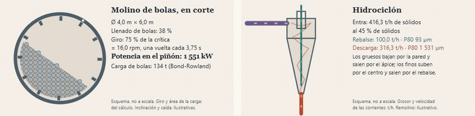
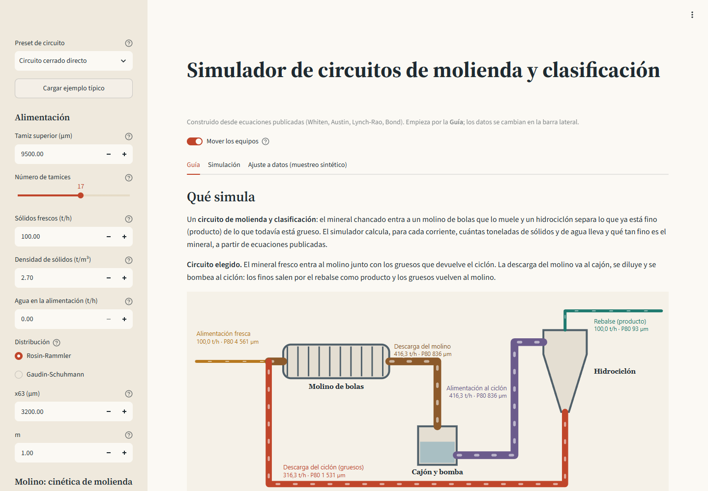
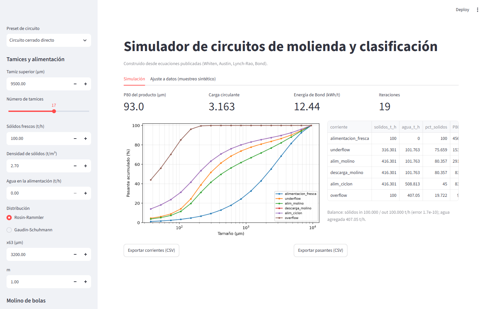
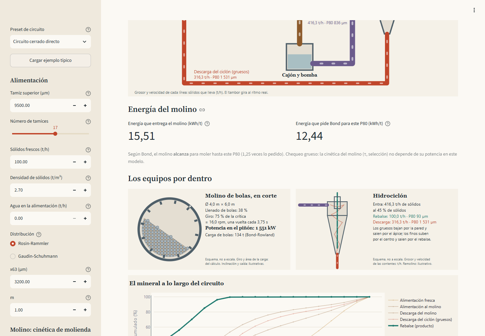
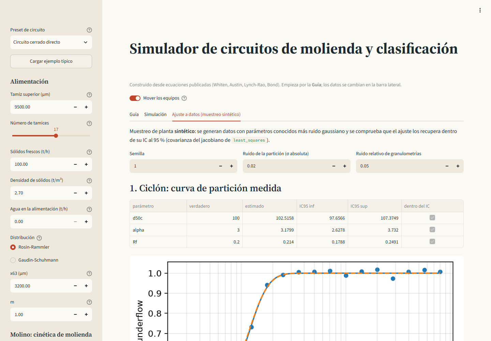

[English version](README.en.md)

# conminucion — grinding & classification circuit simulator

Python simulator for ball-mill / hydrocyclone circuits, built from scratch from published equations (Whiten, Austin, Lynch-Rao, Kelsall, Bond).
Includes a modular flowsheet solver with recycles, plant-data reconciliation and parameter fitting with confidence intervals, and a Streamlit app.

[](https://github.com/Laxionx/simulador-conminucion/actions/workflows/ci.yml)
[](https://simulador-conminucion-mtxoolyzuvvcxrq8rce3el.streamlit.app/)



**[Pruébalo en el navegador](https://simulador-conminucion-mtxoolyzuvvcxrq8rce3el.streamlit.app/),
sin instalar nada.** Si nadie la usó en unos días, la app está dormida: el botón para despertarla
tarda un minuto. La app tiene un selector Español / English arriba de la barra lateral; con `?lang=en` abre en inglés.

## Qué es

Un simulador de circuitos de molienda y clasificación para aprender y practicar balance de
masa en conminución. Resuelve molino de bolas (mezcla perfecta, Whiten/Austin), clasificación
por curva de eficiencia con bypass (hidrociclón y harnero), energía de Bond, circuitos con
reciclo (abierto, cerrado directo y cerrado inverso), reconciliación de balance en un nodo y
ajuste de parámetros a datos de planta con intervalos de confianza del 95 %.

## Por qué se hizo desde las ecuaciones publicadas

Los simuladores industriales de referencia (por ejemplo JKSimMet) son software cerrado. Este
proyecto **no** copia, descompila ni imita código, archivos, formatos o interfaz de ninguno:
todo sale de las ecuaciones de la literatura, documentadas una por una en
[`docs/teoria.md`](docs/teoria.md). Escribirlo así obliga a entender cada supuesto
(normalización de la fractura, interpolación de P80, criterio de convergencia del reciclo).

## Capturas

| Guía: qué simula y qué datos necesita | Simulación con el diagrama animado |
|---|---|
|  |  |
| **Energía y los equipos por dentro** | **Ajuste con muestreo sintético** |
|  |  |

En la app, el tambor gira a las rpm reales del molino (% de la velocidad crítica), la carga de
bolas ocupa el llenado dado y cada corriente se dibuja con el grosor y la velocidad de su
caudal. Con «reducir movimiento» activado en el sistema, los esquemas se muestran quietos.

## Cómo correrlo

```bash
python -m venv .venv
.venv/Scripts/activate        # Windows (Git Bash: source .venv/Scripts/activate); Linux/macOS: source .venv/bin/activate
pip install -r requirements.txt
pip install -e .
streamlit run app/streamlit_app.py
```

Pruebas y estilo:

```bash
ruff check .
pytest --cov=conminucion --cov-report=term-missing
```

Caso de validación cruzada (regenera `docs/caso-validacion-modsim.md`):

```bash
python -m conminucion.validacion
```

Uso como librería:

```python
from conminucion.sizes import SizeGrid, rosin_rammler
from conminucion.stream import Stream
from conminucion.mill import BallMill
from conminucion.classifier import EfficiencyCurve
from conminucion.circuits import CircuitConfig, simulate

grid = SizeGrid.geometric(top=9500, n=17)
fresh = Stream.from_fractions(grid, rosin_rammler(grid, 3200, 1.0), tph=100)
res = simulate("cerrado_directo", CircuitConfig(fresh, BallMill(), EfficiencyCurve(100, 3.0, 0.2)))
print(res.table(), res.circulating_load, res.bond_kwh_t)
```

## Qué incluye

- Clases de tamaño, generadores Rosin-Rammler y Gaudin-Schuhmann, P80/F80 log-lineales.
- Fractura de Austin-Klimpel-Luckie normalizada (columnas suman 1, demostrado en teoría).
- Molino de mezcla perfecta con (r/d) por nudos o función de selección de Austin, N mezcladores.
- Curva de eficiencia de Whiten/Lynch-Rao con bypass de Kelsall (ciclón y harnero).
- Molino con selección específica de energía de Herbst y Fuerstenau: escala con la potencia
  neta, sin tiempo de residencia (equivale al modelo HFSU de MODSIM).
- Potencia del molino de bolas desde sus dimensiones, carga y velocidad (Bond-Rowland),
  validada contra ejemplos resueltos publicados.
- Desgaste de bolas: carga estacionaria con la ley general d^Δ, balance de recarga y vida de
  bolas, y las correlaciones de consumo de Bond (1964). Validado con cargas medidas en planta
  (Davis 1919); ver [docs/desgaste.md](docs/desgaste.md).
- Chancadora de cono estándar y de cabeza corta (clasificación interna y fractura de Whiten):
  reproduce los reportes de MODSIM con un desvío de 0,009 puntos o menos; ver
  [docs/chancado.md](docs/chancado.md).
- Hidrociclón de Plitt (forma de King, modelo CYCL de MODSIM): d50c, nitidez y partición de
  agua desde la geometría, con aviso de embanque de Mular y Jull. Reproduce los resultados de
  MODSIM; ver [docs/plitt.md](docs/plitt.md).
- Clasificador por índice de nitidez d25/d75 (logístico, Rosin-Rammler o suma exponencial),
  con bypass y escalado del d50 por densidad (equivale al modelo CYCA de MODSIM).
- Solucionador secuencial-modular con corrientes de corte y Wegstein opcional.
- Reconciliación de nodo por mínimos cuadrados ponderados con restricciones.
- Ajuste de d50c, α y Rf (ciclón) y de r/d por nudos (molino), IC por covarianza del jacobiano.
- Muestreo de planta sintético que comprueba la recuperación de parámetros dentro de su IC.
- App Streamlit con una guía (qué simula, ecuaciones, qué datos necesita y cómo se mide cada
  uno en planta), el diagrama de flujo y los equipos animados con datos del cálculo, la
  convergencia del reciclo y la granulometría etapa por etapa, potencia del molino
  (Bond-Rowland), curvas de pasante, tabla de corrientes y CSV.

## Ensayo de Bond virtual

La pestaña «Ensayo de Bond» muestra, ciclo a ciclo, cómo se hace el ensayo del molino de bolas
(305 × 305 mm, 70 rpm, 250 % de carga circulante) y de dónde sale el Wi, con dos partes:

- **Calculadora** (`conminucion/ensayo_bond.py`): la contabilidad del procedimiento de GMG (2021,
  abierta). Reproduce los 11 ciclos de la magnetita de Hebei (Liang et al., 2016, *Minerals* 6(2),
  39, CC BY): Gbp final 2,5811 g/rev y Wi 10,92 kWh/t frente a 10,93 publicado. De las 11 filas,
  9 coinciden en el Gbp a 4 decimales y 2 difieren en 0,001 por el redondeo a 0,1 g de una
  columna; las revoluciones coinciden en 10 de 11: la fila 4 publica 106, pero su Gbp
  (291,5 g / 126 = 2,3135) y la regla de GMG dan 126, así que parece una errata del artículo.
- **Simulación**: molienda por lotes de primer orden (exponencial de matriz, selección y fractura
  de Austin) con tamizado ideal, ajustada **solo** a los finos nuevos de los ciclos 1 y 2 (dos
  parámetros, *a* y α) para predecir los ciclos 3 a 11. Los cortes se fijaron antes de correr:
  Gbp final y Wi a ±10 % de lo medido.

| Resultado | Simulado | Medido | Error | Corte ±10 % |
|---|---|---|---|---|
| Gbp final (g/rev) | 2,7439 | 2,5811 | +6,3 % | pasa |
| P80 del producto (µm) | 106,5 | 119,6 | −10,9 % | no pasa |
| Wi (kWh/t) | 9,59 | 10,93 | −12,3 % | **no pasa** |

El Wi simulado **no pasa**, y se deja así: es un resultado negativo (queda como `xfail` estricto
en las pruebas), sin ajustar más parámetros para que cuadre. Una revisión de 2023, «The truth
about population balance modeling», sostiene que un ensayo por lotes no predice el de ciclo
cerrado en minerales heterogéneos; aquí el producto simulado sale más fino que el medido.
Supuestos declarados: alimentación Rosin-Rammler por dos puntos (F80 y % bajo el tamiz; la curva
completa del artículo es un gráfico), grilla casi √2 desde 3 350 µm con el tamiz de 150 µm
exacto, y μ, Λ y la fractura en los valores por defecto del simulador (no medidos para esa mena).

## Alcance y limitaciones honestas

- **No reemplaza a un simulador industrial calibrado.** Los parámetros por defecto son
  razonables pero no están calibrados con datos reales de una planta.
- **Validado contra 3 plantas reales publicadas:** ciclones de Vazante, balance de Madneuli
  y energía de Bond de Constancia. Las tolerancias se fijaron antes de correr. Detalle y
  hallazgos en [docs/VALIDACION_PLANTAS_REALES.md](docs/VALIDACION_PLANTAS_REALES.md).
- **Reproduce el ejemplo Bougainville de MODSIM 3.6.24** dentro de la tolerancia de
  convergencia de MODSIM:
  - carga circulante a −0,06 %;
  - las 4 granulometrías a 0,025 puntos o menos.

  Para lograrlo hubo que usar sus convenciones de tamaño de clase y de fractura, que quedaron
  como opciones.
- Un solo mineral (una densidad de sólidos), sin liberación ni mineralogía.
- El molino es de mezcla perfecta. La potencia de `EnergyBallMill` se puede calcular desde las
  dimensiones con Bond-Rowland (`bond_mill_power`). Los modelos de Morrell y Austin no están,
  porque no hay datos públicos para validarlos.
- El ciclón de Plitt se comparó contra MODSIM, no contra ciclones medidos. Sin calibrar,
  Plitt predice mal en planta: sus tres factores se deben ajustar con un muestreo.
- Los IC por jacobiano son una aproximación lineal; cerca de cotas (Rf = 0) son optimistas.
  La partición derivada de datos reconciliados tiene errores heterocedásticos y su cobertura
  real es menor que la nominal (se observó ~50-80 % en simulaciones de prueba); la
  recuperación dentro de IC está garantizada y probada para la curva de partición medida y
  para los nudos del molino.
- El caso sintético de `docs/caso-validacion-modsim.md` sigue **pendiente de que el usuario
  cargue los datos** en MODSIM. El ejemplo Bougainville, en cambio, sí se comparó.
- La energía de Bond usa Wi constante, sin factores de corrección de eficiencia. En
  Constancia, con mineral supérgeno, la planta gastó en promedio 40 % más que Bond.
- Las páginas exactas de algunas referencias (Kelsall, Bond, Lynch-Rao) no fueron
  verificadas contra el original.

## Fase 2

- Plitt con la corrección de Flintoff (1987) y el criterio de embanque de Concha. Plitt sí
  está, en la forma de MODSIM. Las constantes publicadas no coinciden entre las fuentes por web
  y el artículo original (CIM Bulletin 69(776), 114-123) es de pago.
- Molino SAG/AG, chancadora primaria y flotación.
- Bootstrap de residuos como alternativa de IC.
- Mezcla de varios minerales y densidades distintas.

## Estructura

```
conminucion/   sizes, stream, fracture, mill, classifier, bond, units, flowsheet,
               circuits, reconcile, fitting, synthetic, validacion, plantas_reales, power,
               desgaste, chancadora, plitt, modsim, ensayo_bond
app/           streamlit_app.py (+ textos_es*.py y textos_en*.py: los textos de cada idioma)
docs/          teoria.md, caso-validacion-modsim.md, VALIDACION_PLANTAS_REALES.md,
               desgaste.md, chancado.md, plitt.md, img/
tests/         pytest (cobertura >= 90 %)
```

Licencia MIT. Construido con desarrollo asistido por IA (Claude Code), con revisión y pruebas propias.
